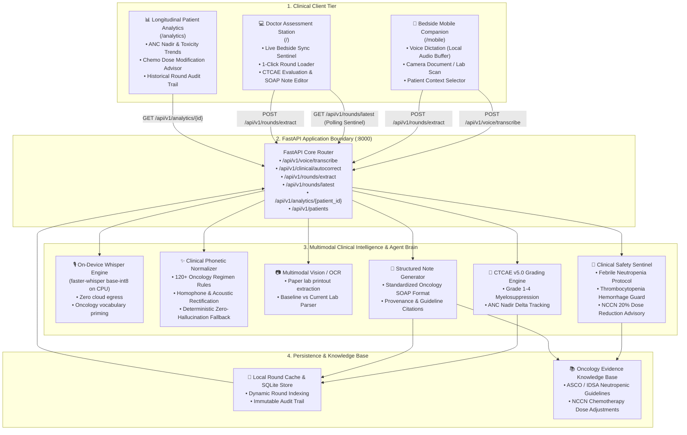
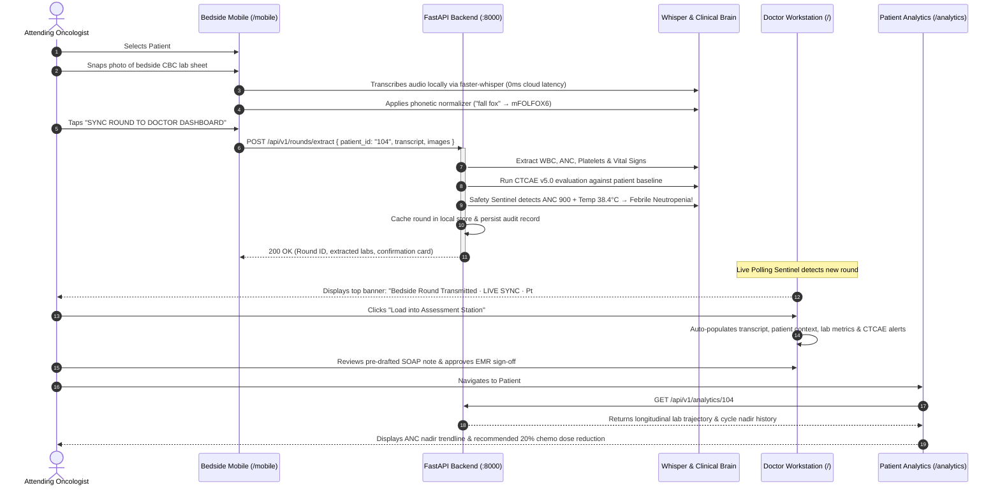

# 🩺 RoundsAI — Inpatient Oncology Round Intelligence

> **Turn a 20-minute inpatient oncology round into a structured, evidence-linked clinical note in under 2 minutes — with zero cloud audio privacy leakage and ₹0 API cost.**

[](https://fastapi.tiangolo.com)
[](https://nextjs.org)
[](https://www.typescriptlang.org)
[](https://www.python.org)
[](https://github.com/openai/whisper)
[](https://ai.google.dev)
[](LICENSE)

---

## 📋 Executive Overview

Inpatient oncology rounds are among the most cognitively demanding workflows in hospital medicine. Clinicians must simultaneously synthesize patient-reported symptoms, decipher printed laboratory sheets, calculate chemotherapy toxicity nadirs, and cross-reference clinical practice guidelines under extreme time constraints.

**RoundsAI** is a multimodal clinical intelligence copilot built specifically for the inpatient oncology ward:
- **Bedside Mobile Companion (`/mobile`)**: Oncologists dictate clinical observations on the move or scan bedside lab reports with their mobile camera.
- **Privacy-First On-Device Whisper AI**: Voice dictation is transcribed 100% locally on CPU via `faster-whisper` (base int8), designed for zero audio egress in local mode with **₹0 cloud API fees**.
- **Specialized Oncology Normalizer**: A clinical phonetic engine corrects 120+ oncology acoustic homophones (*"fall fox"* $\rightarrow$ **mFOLFOX6**, *"anc nine hundred"* $\rightarrow$ **ANC 900 /µL**).
- **Instant Bedside-to-Desktop Synchronization**: 1-tap transmission immediately triggers a live sentinel banner on the desktop workstation with 1-click loading.
- **Automated CTCAE v5.0 Toxicity Grading**: Calculates baseline-to-current lab deltas and detects Grade 1–4 myelosuppression.
- **Assistive Safety Sentinels**: Flags configured clinical criteria (e.g., **Febrile Neutropenia** screening criteria per IDSA/ASCO 2018) as `"Criterion met, for clinician review"` alongside neutral guideline reference citations.
- **Longitudinal Patient Analytics (`/analytics`)**: Charts ANC/WBC/Platelet nadirs across chemotherapy cycles, predicts recovery windows, and recommends guideline-concordant dose modifications.
- **Hospital EMR Grade UI**: Clean, distraction-free interface built with Lucide-style vector SVG icons, tabular monospace lab typography, and strict 0-emoji compliance.

---

## 🏛️ System Architecture



---

## 🔄 End-to-End Clinical Round Flow



---

## ⚡ Key Features

### 1. High-Accuracy Voice & Zero-Cost Clinical Transcription
- **On-Device Whisper**: Employs `faster-whisper` (base int8) running locally on CPU. No external audio APIs, designed for zero audio egress in local mode and ₹0 per-minute billing.
- **120+ Specialized Oncology Regimens**: Normalizes acoustic homophones:
  - *Chemotherapy*: `"fall fox"` $\rightarrow$ `mFOLFOX6`, `"carbo taxol"` $\rightarrow$ `Carboplatin + Paclitaxel`, `"our chop"` $\rightarrow$ `R-CHOP`, `"fol fir inox"` $\rightarrow$ `FOLFIRINOX`.
  - *Lab Counts*: `"anc nine hundred"` $\rightarrow$ `ANC 900 /µL`, `"platelets one forty five k"` $\rightarrow$ `Platelets 145,000 /µL`.
  - *Clinical Terms*: `"a febrile"` $\rightarrow$ `afebrile`, `"sensory pare sthesia"` $\rightarrow$ `sensory paresthesia`.
- **Clinician Oversight Banner**: Displays automated diff notices with a 1-click **Undo** safeguard to revert any automatic text change.

### 2. Bedside-to-Desktop Live Synchronization
- Bedside mobile companion sends captured speech, photographs, and selected patient ID.
- Desktop workstation features an automatic background sentinel that detects newly transmitted bedside rounds.
- 1-click **"Load into Assessment Station"** transfers the complete clinical encounter to desktop without re-typing.

### 3. Automated CTCAE v5.0 & Clinical Safety Sentinels
- **Febrile Neutropenia Screening**: When the configured fever criterion is met alongside a critically low ANC, the system surfaces a `"Criterion met, for clinician review"` sentinel alert citing the IDSA/ASCO (Taplitz et al., 2018) guideline. The alert text states only what the configured rule actually checks; it does not prescribe treatment or attribute specific management steps to the guideline. Thresholds are configurable and require clinical review.
- **Myelosuppression Grading**: Computes baseline vs. current lab delta and classifies Grade 1–4 myelosuppression per CTCAE v5.0 (NCI, November 27, 2017).
- **Thrombocytopenia & Anemia Sentinels**: Flags critical platelet and hemoglobin values with neutral guideline citations (NCCN Hematopoietic Growth Factors; ASCO/ASH Anemia Guideline).

### 4. Longitudinal Patient Analytics
- Cycle-over-cycle laboratory trend charts for Absolute Neutrophil Count (ANC), White Blood Cells (WBC), and Platelets.
- Real-time toxicity trajectory and clinical recovery estimation.
- Historical ward round timeline with clinician sign-off timestamps and approved SOAP notes.

### 5. Hospital-Grade UI & Typography
- Strict **0-emoji design standard** with 22+ custom enterprise vector SVG icons.
- Tabular figures (`font-feature-settings: "tnum"`) for aligned clinical lab metrics.
- High-contrast clinical slate/navy color scheme.

---

## 🛠️ Technology Stack

| Layer | Technologies | Role |
| :--- | :--- | :--- |
| **Frontend** | Next.js 15 (App Router), React 19, TypeScript, Vanilla CSS | Doctor Workstation, Bedside Mobile Companion, Longitudinal Analytics |
| **Backend** | FastAPI, Python 3.12+, Uvicorn, Pydantic v2 | High-performance asynchronous REST API & clinical routing |
| **Local Speech AI** | `faster-whisper` (base int8), CTranslate2, Web Speech API | Offline, zero-cloud transcription on CPU |
| **Multimodal Vision** | Google Gemini 3.5 Flash / 3.5 Flash-Lite SDK | Multimodal lab sheet transcription & document analysis |
| **Clinical Logic** | CTCAE v5.0 Scoring Matrix, NCCN / ASCO Guidelines | Automated toxicity grading and safety sentinels |
| **Data & Storage** | In-memory cache, PostgreSQL, Supabase integration | Longitudinal patient census & round audit logging |

---

## 🚀 Quickstart & Local Setup

### Prerequisites
- **Python**: 3.11 or higher
- **Node.js**: 18.x or higher (npm 9+)
- **Git**

### 1. Clone the Repository
```bash
git clone https://github.com/santhoshh005/Rounds_AI.git
cd Rounds_AI
```

### 2. Setup & Launch Backend
Open a terminal in the project root:

```powershell
# Create and activate Python virtual environment
py -m venv .venv
.\.venv\Scripts\Activate.ps1

# Install backend dependencies
pip install -r backend\requirements.txt

# Configure environment variables
Copy-Item .env.example .env

# Start FastAPI server
python -m uvicorn backend.api.main:app --host 0.0.0.0 --port 8000
```
*API health check available at [http://localhost:8000/health](http://localhost:8000/health) and Swagger documentation at [http://localhost:8000/docs](http://localhost:8000/docs).*

### 3. Setup & Launch Frontend
Open a second terminal in the `apps/web` directory:

```bash
cd apps/web
npm install
npm run dev
```
*Application available at [http://localhost:3000](http://localhost:3000).*

### 4. Supabase Database Migration (`patients` Table & Row Level Security)
To create the `public.patients` table (and add the `draft_notes.approved_by` and `review_flags.guideline` columns) in your Supabase project:

1. **Via Supabase Dashboard SQL Editor (Recommended)**:
   - Open your project in the [Supabase Dashboard](https://supabase.com/dashboard) and navigate to **SQL Editor** $\rightarrow$ **New Query**.
   - Paste the contents of [`supabase/migrations/20261010_create_patients_table.sql`](supabase/migrations/20261010_create_patients_table.sql) and click **Run**.
   - Go to **Project Settings** $\rightarrow$ **API** and click **Reload schema cache** (or run `NOTIFY pgrst, 'reload schema';`) so PostgREST immediately recognizes `public.patients`.
2. **Via Supabase CLI**:
   ```bash
   supabase db push
   ```

> [!IMPORTANT]
> **Row Level Security (RLS) Status**:
> On the existing Supabase tables (`rounds`, `extractions`, `draft_notes`, `review_flags`), unauthenticated `SELECT` and `INSERT` calls using `SUPABASE_ANON_KEY` succeed without a user JWT, indicating that RLS is currently either disabled on those tables or configured with a permissive `anon` policy. The migration file [`supabase/migrations/20261010_create_patients_table.sql`](supabase/migrations/20261010_create_patients_table.sql) enables RLS on `public.patients` (`ALTER TABLE public.patients ENABLE ROW LEVEL SECURITY;`) with a demo access policy; for production deployments, restrict table policies to `authenticated` / `service_role` only.
>
> **Test Isolation**:
> Automated test runs (`pytest` and `test_features.py`) automatically set `TEST_MODE=true` / `X-Test-Mode: true`, which strictly skips all Supabase network reads/writes so tests never write rows to your Supabase project.

---

## 🌐 Application Routes

| Route | View | Description |
| :--- | :--- | :--- |
| `/` | **Doctor Assessment Station** | Desktop review station, live bedside sync banner, CTCAE grading, SOAP note editor |
| `/mobile` | **Bedside Mobile Companion** | Fast voice dictation, camera lab sheet capture, 1-tap dashboard sync |
| `/analytics` | **Patient Longitudinal Analytics** | Patient trajectory graphs, ANC nadir trends, cycle dose adjustment recommendations |
| `/login` | **Clinician Authentication** | Secure role-based staff authentication |

---

## 📁 Repository Structure

```text
├── apps/
│   └── web/
│       ├── app/
│       │   ├── components/
│       │   │   └── Icons.tsx           # Hospital-grade Lucide vector SVG icons
│       │   ├── mobile/page.tsx         # Bedside Mobile Capture Companion
│       │   ├── analytics/page.tsx      # Longitudinal Patient Analytics Dashboard
│       │   ├── login/page.tsx          # Clinician Authentication
│       │   ├── page.tsx                # Doctor Assessment Station & Sync Sentinel
│       │   ├── layout.tsx              # Root Layout & Clinical Navigation Shell
│       │   └── styles.css              # Hospital EMR typography & theme styling
│       ├── lib/
│       │   └── firebase.ts             # Firebase client configuration & auth
│       ├── package.json
│       └── tsconfig.json
├── backend/
│   ├── api/
│   │   └── main.py                     # FastAPI REST routes & application entrypoint
│   ├── agents/
│   │   └── round_graph.py              # LangGraph multi-agent clinical workflow
│   ├── models/
│   │   ├── analytics.py                # Longitudinal analytics models
│   │   ├── patient.py                  # Patient demographic & lab schemas
│   │   └── round.py                    # Round request/response schemas
│   ├── services/
│   │   ├── voice_transcriber.py        # Local faster-whisper base-int8 pipeline
│   │   ├── clinical_autocorrect.py     # 120+ oncology phonetic regex normalizer
│   │   ├── patient_analytics.py        # Longitudinal trends & CTCAE calculator
│   │   ├── persistence.py              # Round cache & database storage
│   │   ├── gemini_extractor.py         # Gemini LLM clinical structured extractor
│   │   ├── gemini_vision.py            # Multimodal vision lab report extractor
│   │   ├── local_extractor.py          # Deterministic local regex extractor
│   │   ├── patient_service.py          # Patient census management
│   │   └── rag_service.py              # Clinical guideline retrieval & grounding
│   └── requirements.txt
├── docs/
│   ├── HACKATHON_SUBMISSION.md         # Comprehensive hackathon dossier
│   ├── demo-script.md                  # 5-minute presentation & demo script
│   └── architecture.md                 # System architecture overview
├── knowledge/
│   ├── Lab_Report_01.png               # Sample bedside CBC lab report scan
│   └── oncology_guidelines.json        # Curated NCCN/ASCO clinical guidelines
└── README.md                           # Project documentation
```

---

## 🔒 Clinical Safety, Privacy Modes & Accuracy Safeguards

### 1. Privacy Modes & Audio Egress Controls
RoundsAI is engineered with a strict privacy-first architecture controlled via the `TRANSCRIPTION_MODE` configuration:
- **`local` (Default — Zero Audio Egress)**: Voice recordings are processed entirely on-device on CPU via `faster-whisper` (int8 quantized). Zero audio bytes leave the clinician's workstation or device firewall, designed for zero audio egress in local mode with ₹0 cloud API fees.
- **`cloud`**: Utilizes Google Gemini audio processing (`gemini-3.5-flash`) when cloud processing is explicitly authorized by hospital policy.
- **`hybrid`**: Attempts low-latency cloud transcription with seamless local on-device fallback if network connectivity drops.

The active mode is displayed directly in the header and toolbar (`STT: LOCAL (0 Egress)`), and speech recognition types are fully typed without dynamic `any` window casts.

### 2. Clinical Accuracy & Hallucination Prevention
To eliminate hallucinations in high-stakes oncology inpatient environments, RoundsAI implements deterministic safeguards:
- **Zero Invented Clinical Values**: The system never invents or hallucinates clinical metrics. Missing, ambiguous, or out-of-range values are flagged as `needs_confirmation` and surfaced in the interactive **"Confirm Before Signing"** review queue.
- **LLM Polish Diff Verification Guard**: Any LLM-assisted note polishing is verified against the original dictation via a strict diff checker. If any numeric digit, laboratory unit, medication name, or negation term is mutated, the LLM output is rejected immediately in favor of deterministic rule-based text.
- **Laboratory Normalization & Physiological Range Checks**: Standardizes units (e.g. ANC to `cells/µL`, Hemoglobin to `g/dL`, Platelets to `/µL`) and inspects biological plausibility boundaries, flagging possible 10× scaling or dictation errors for confirmation.
- **Deterministic Negation & Temporality Engine**: Uses rule-based regex parsing to differentiate acute ongoing fevers from negated or historical observations (`"no fever"`, `"afebrile"`, `"fever resolved"`, `"fever yesterday"` vs `"fever since yesterday"`), eliminating false-alarm Febrile Neutropenia alerts.
- **Deterministic CTCAE v5.0 Toxicity Grading**: Evaluates myelosuppression and toxicities against a canonical, versioned configuration table (`CTCAE v5.0, November 27, 2017`), citing standard practice guidelines (ASCO/IDSA and NCCN).
- **Human-in-the-Loop Attestation**: Notes remain strictly in `status="draft"` until a licensed clinician reviews and clicks **"ATTEST & APPROVE NOTE"**. Sign-off is locked while unconfirmed items remain in the queue.
- **Assistive Documentation Boundaries**: Alerts are strictly assistive and non-prescriptive, always phrased as `"Criterion met, for clinician review: ..."` rather than autonomous diagnostic claims or treatment orders.
- **Thread-Safe Resilient Persistence**: In-memory stores are protected by threading locks (`threading.Lock`), and database write failures trigger a prominent `"Saved Locally Only"` warning in the UI without losing clinician work.

### 3. Authentication & Client Credentials Notice
> [!WARNING]
> `NEXT_PUBLIC_API_KEY` is embedded directly into client-side browser bundles and is visible in browser dev tools / network inspectors. It is intended strictly for prototype and demonstration purposes.
>
> **Clinician Identity & Note Sign-Off Limitations**:
> Client-supplied headers (such as `X-Verified-User` or `X-Authenticated-Clinician`) are untrusted and rejected by the server because any client could spoof them. The backend only records an attested identity if a cryptographically valid Firebase ID token is supplied in the `Authorization: Bearer <token>` header and validated server-side. In all other cases (including client request bodies and mock credentials), `approved_by` is strictly and permanently recorded as `"unverified (client-supplied)"`.

---

## 🔑 Required Environment Variables

Copy `.env.example` to `.env` and fill in the values marked `REQUIRED`.

| Variable | Required | Description |
| :--- | :--- | :--- |
| `GEMINI_API_KEY` | Optional | Enables Gemini vision, extraction, and polish. Omit to use local rules only. |
| `LLM_PROVIDER` | Optional | `local` (default) or `gemini`. |
| `GEMINI_MODEL_VISION` | Optional | Gemini model for lab image OCR (default: `gemini-3.5-flash`). |
| `GEMINI_MODEL_DRAFT` | Optional | Gemini model for extraction drafting (default: `gemini-3.5-flash`). |
| `GEMINI_MODEL_POLISH` | Optional | Gemini model for note polish (default: `gemini-3.5-flash-lite`). |
| `TRANSCRIPTION_MODE` | Optional | `local` / `cloud` / `hybrid` (default: `local`). |
| `WHISPER_MODEL_SIZE` | Optional | faster-whisper model size (default: `base`). |
| `ALLOWED_ORIGINS` | Optional | Comma-separated CORS origins. |
| `REQUIRE_AUTH` | Optional | `true` to require `API_KEY` or Bearer token on all endpoints. |
| `API_KEY` | If REQUIRE_AUTH=true | Server-side API key for `X-API-Key` header or Bearer token. |
| `NEXT_PUBLIC_API_URL` | Optional | Backend URL for the frontend (default: `http://localhost:8000`). |
| `NEXT_PUBLIC_API_KEY` | Optional | ⚠️ Visible in browser. Demo use only. |
| `SUPABASE_URL` | **REQUIRED** for DB | Your Supabase project URL. |
| `SUPABASE_SERVICE_ROLE_KEY` | Recommended | Server-side only. Bypasses RLS. **Never use in NEXT_PUBLIC_ vars or frontend code.** Preferred over anon key when set. |
| `SUPABASE_ANON_KEY` | Fallback | Used when SERVICE_ROLE_KEY is absent. Subject to Row Level Security. |
| `NEXT_PUBLIC_FIREBASE_*` | Optional | Firebase client auth configuration (6 variables, see `.env.example`). |
| `DEMO_MODE` | Optional | `true` enables synthetic demo data labeled `[DEMO DATA]`. Off by default. |
| `TEST_MODE` | Optional | `true` disables all Supabase writes for this server instance. CI/test use only. |

---

## 🔒 Privacy Modes (TRANSCRIPTION_MODE)

| Mode | Audio Egress | Description |
| :--- | :--- | :--- |
| `local` (default) | **Zero** | faster-whisper int8 on CPU. No audio bytes leave the device. |
| `cloud` | All audio sent to Gemini API | Uses Gemini multimodal audio; requires valid `GEMINI_API_KEY`. |
| `hybrid` | Cloud first, local fallback | Attempts cloud; falls back to on-device if unavailable. |

---

## 🧪 DEMO_MODE and TEST_MODE

| Mode | Purpose | Effect |
| :--- | :--- | :--- |
| `DEMO_MODE=true` | Presentations and screenshots | Enables synthetic patient trajectories and fallback vision values. Every synthetic value is labeled `[DEMO DATA]`. Shown in UI header and analytics. |
| `TEST_MODE=true` | CI / automated test runs | Disables all Supabase DB writes and reads. Shown in logs (WARNING level), in `/health` response, and in a red "PERSISTENCE DISABLED" banner in the UI. **Never use in production.** A client sending `X-Test-Mode: true` header has no effect unless the server was started with `TEST_MODE=true`. |

---

## ⚠️ NOT TESTED / KNOWN LIMITATIONS

The following capabilities have NOT been tested with real-world inputs in this version and require further validation before any clinical deployment:

1. **Real phone-photo lab OCR**: The vision pipeline has only been tested with a single synthetic lab PNG in an automated test. Real-world photo quality, lighting variation, and handwritten values have not been evaluated.

2. **Real microphone audio through Whisper**: Local faster-whisper transcription runs in the server environment but has only been invoked via `b"mock audio bytes"` in tests. Actual microphone audio captured in a clinical environment has not been tested end-to-end.

3. **Browser UI interaction**: All UI testing is screenshot-only. No automated end-to-end browser interaction (click flows, dictation, image upload, approve button) has been run.

4. **Firebase token verification of `approved_by`**: The server attempts `firebase_admin.auth.verify_id_token()` when a `Bearer` token is supplied, but this code path has not been tested with a real Firebase-issued JWT. In all current test runs, `approved_by` is stored as `"unverified (client-supplied)"`.

5. **Clinician review of alert thresholds and wording**: All CTCAE v5.0 thresholds, febrile neutropenia criteria, and alert message wording must be reviewed and approved by a licensed oncologist before any clinical use. These are not validated medical devices.

6. **Supabase Row Level Security in production**: RLS is currently disabled on the live project tables (rounds, extractions, draft_notes, review_flags). The migration file `20261010b_enable_rls.sql` must be applied and tested before any deployment with real patient data.

7. **Multi-user authentication**: The current backend enforces a single shared `API_KEY`. Per-user Firebase identity is read from the Bearer token but is only used for `approved_by` attribution, not for data isolation between users.

> [!CAUTION]
> This is a **research and demonstration prototype**. It must not be used for autonomous clinical decision-making, real patient data, or production hospital workflows without independent clinical validation, regulatory review, and appropriate data governance controls.

---

## 📄 License

This project is licensed under the MIT License — see the [LICENSE](LICENSE) file for details.

