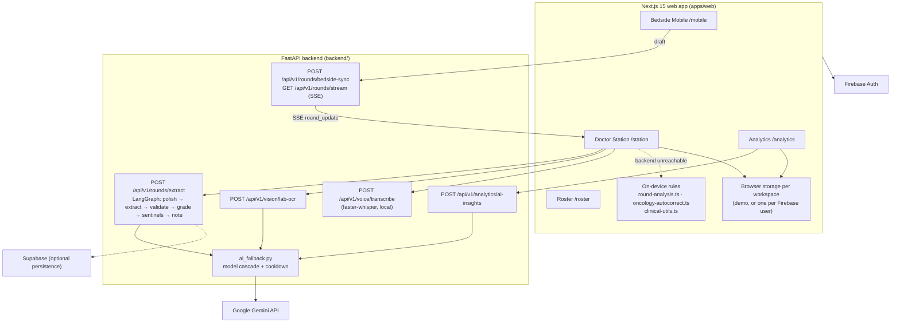
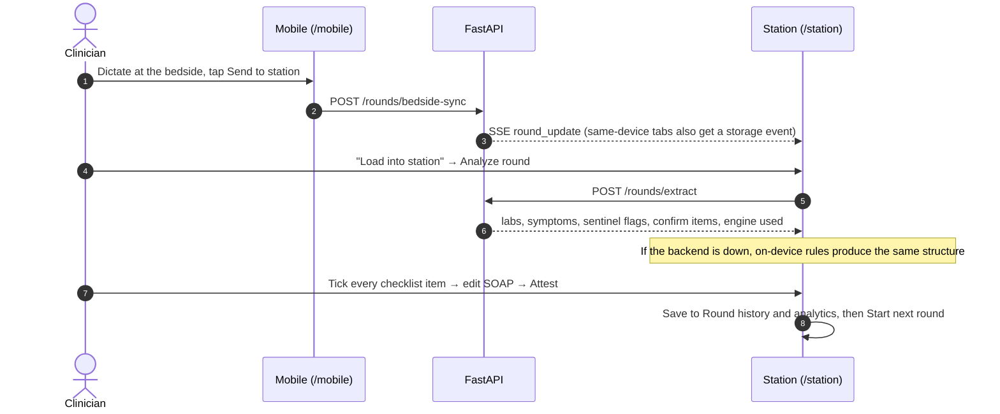

# 🩺 RoundsAI — Inpatient Oncology Ward Copilot

> Capture the bedside round by voice or text, get CTCAE v5.0–graded findings and a draft SOAP note, verify every item, attest — and keep each round as history for the next one. The clinician decides; RoundsAI does the paperwork around them.

[](https://rounds-ai-umber.vercel.app/)
[](https://youtu.be/DSOc0GQX6lI)
[](https://rounds-ai-backend.onrender.com/health)
[](LICENSE)

[](https://fastapi.tiangolo.com)
[](https://nextjs.org)
[](https://www.typescriptlang.org)
[](https://www.python.org)
[](https://github.com/SYSTRAN/faster-whisper)
[](https://ai.google.dev)

**Health-a-thon 2026 · Team Binary Minds (1RKUPH)** · Track: Cancer — Doctor / Care Team — Doctor Productivity & Knowledge Assistant

🎬 **Walkthrough video:** [youtu.be/DSOc0GQX6lI](https://youtu.be/DSOc0GQX6lI) — the team, our approach with our clinical partner, and a narrated demo of the working app.

---

## 📋 Overview

Inpatient oncology rounds combine spoken observations, printed CBC sheets, toxicity grading against CTCAE thresholds and note writing — under time pressure, and with time-critical escalations such as febrile neutropenia.

RoundsAI is a web application with three connected surfaces:

| Surface | Route | What it does |
| :--- | :--- | :--- |
| **Doctor Assessment Station** | `/station` | Capture (dictate / type / attach lab report) → **Analyze** → Review graded findings and a checklist → Sign the SOAP note → **Start next round**. Shows the fixed admission baseline and the patient's round history. |
| **Bedside Mobile Companion** | `/mobile` | Dictate at the bedside, scan a lab sheet, and send the draft to the station (live over SSE, or between tabs on one device). |
| **Longitudinal Analytics** | `/analytics` | ANC nadir trajectory, platelet and hemoglobin recovery chart, KPIs from the latest round, trajectory insight, NCCN-style dose-modification advice and the round audit log. |
| **Ward Roster** | `/roster` | Admit (with an optional admission baseline), edit, and discharge patients; bed-conflict checks. |

> **Everything shown to the clinician is derived from what was recorded.** Values that were not dictated or scanned are shown as *Not recorded* — they are never filled in from demo profiles or estimated.

---

## ⚡ Features

### Capture
- **Two speech engines:** *Whisper STT* — `faster-whisper` (int8, CPU; `tiny` model by default, `base` optional) on the RoundsAI backend; audio goes only to your own server (default `TRANSCRIPTION_MODE=local`). If Whisper is unavailable the app says so and never substitutes another speech service. *Live ASR* — the browser's Web Speech API for real-time text; in Chrome this audio is processed by Google's speech service. The UI states which applies for the selected engine.
- **Oncology auto-correct with review:** 92 in-browser rules and 102 server rules (each matching several spoken variants) fix misheard terms — e.g. *"our chop"* → **R-CHOP**, *"ox ally platin"* → **oxaliplatin**, *"Anarcho AMC"* → **ANC**. Every correction is shown with a confidence score and can be accepted or rejected individually; *"a febrile episode"* is protected from being rewritten to *"afebrile"*.
- **Lab-report upload (`+`):** text reports (`.txt/.csv/.json`) are parsed on-device; PNG/JPEG/WebP images are read by **Gemini Vision** through `POST /api/v1/vision/lab-ocr` (nothing is stored). Extracted values open in a review modal for confirmation before they are committed. If the vision model is unavailable the modal says so and asks for manual entry.

### Analyze → Review → Sign
- **Analyze round** sends the dictation to the backend pipeline (`POST /api/v1/rounds/extract`: polish → extraction → lab validation → CTCAE grading → sentinels → draft note). If the backend is unreachable the same analysis runs **on-device** with deterministic rules, and the UI says which engine produced the result.
- **CTCAE v5.0 grading** of ANC, platelets, WBC and hemoglobin (counts normalized to /µL — "88k", "1.8 K/µL" and "x10³" are handled).
- **Febrile-neutropenia sentinel (IDSA/ASCO 2018):** fever = single reading ≥ 38.3 °C or ≥ 38.0 °C sustained ≥ 1 h; criteria met when ANC < 500 /µL, or < 1,000 /µL with a documented expected decline. Fever with ANC 500–999 and no documented decline is still surfaced ("Assess for FN") — it never passes silently.
- **Clause-scoped negation:** "denies cough, dysuria, or focal pain" negates all three; "no fever and reports severe pain" keeps pain active.
- **Verification checklist:** every graded value, the fever criterion and any ambiguous unit becomes a checklist item. All items start **unchecked**; attestation stays locked until each is confirmed.
- **Editable SOAP draft** built from the dictated values, with guideline-based plan suggestions (always ending "All orders require attending confirmation").

### Round history
- Each patient has a **fixed admission baseline** (ANC, platelets, WBC, Hgb, temperature, condition) recorded once at admission.
- **Attest** saves the round (dictation, SOAP note, grades, labs, clinician, time) to **Round history**; **Start next round** opens a blank capture for the updated condition while every previous note stays expandable for reference.

### Analytics
- KPIs are computed from the latest recorded round; the cycle bar reads the real "Cycle N of M".
- Charts plot only measured values (missing hemoglobin is not drawn as a default).
- Trajectory insight: Gemini when available, otherwise a deterministic generator that states nadir, latest value, trend and per-lineage CTCAE grades from recorded data only, and reports **data completeness** instead of a model "confidence".
- Dose-modification advice (Grade 4 → 20% reduction + G-CSF; Grade 3 → delay until ANC ≥ 1,500 /µL and platelets ≥ 100,000 /µL; Grade 0–2 → 100% RDI if pre-cycle counts are adequate), referencing the patient's actual next cycle.

### Accounts and demo
- **Accounts:** Firebase email/password sign-in and sign-up (with password reset and "keep me signed in"). The clinician profile comes from the signed-in user, and each account has its **own isolated ward** (patients, analytics, round history, notifications) — accounts never receive demo data.
- **Demo mode** ("Try demo"): five synthetic patients covering CTCAE Grades 0–4, each with a pre-loaded Round 1, a step-by-step **demo guide**, **Try a scenario** dictations (febrile neutropenia, possible FN, sustained 38.1 °C, low platelets & Hgb, stable, labs pending, speech errors) and downloadable sample lab reports in `apps/web/public/demo/`.

| Demo patient | Bed | Case (Round 2 dictation) |
| :--- | :--- | :--- |
| David Miller (#104) | 12 | ANC 420 /µL + 38.4 °C → febrile neutropenia, Grade 4 |
| Sarah Jenkins (#105) | 14 | ANC 750 /µL + 38.1 °C (not sustained) → Grade 3 neutropenia |
| Robert Chen (#107) | 18 | ANC 1,250 /µL → Grade 2 |
| Emily Watson (#108) | 20 | ANC 1,750 /µL → Grade 1 |
| Elena Rostova (#106) | 16 | ANC 2,150 /µL, afebrile → Grade 0 |

---

## 🏛️ Architecture



### One round, end to end



---

## 🤖 How AI is used

| Task | Primary | Fallback |
| :--- | :--- | :--- |
| Speech-to-text | `faster-whisper` int8 on the backend CPU (Whisper STT, `tiny`/`base`), or the browser Web Speech API (Live ASR; Google's service in Chrome) | — |
| Transcript polish | Rule-based oncology normalizer (default); Gemini only when `GEMINI_POLISH=true`, with a diff guard that rejects any change to numbers, units, drugs or negations (a spoken number written as digits, e.g. "four twenty" → 420, is allowed) | — |
| Clinical extraction | Gemini structured output (`LLM_PROVIDER=gemini`) | Deterministic regex extractor |
| Lab-report images | Gemini Vision (`GEMINI_MODEL_VISION`) | "Image not analyzed — enter values manually" |
| Trajectory insight | Gemini JSON, cached per patient data | Deterministic generator from recorded values |
| CTCAE grading, sentinels, dose advice | **Always deterministic rules** | — |

**Model cascade (`backend/services/ai_fallback.py`):** the configured models (`.env`: `gemini-3.5-flash`, polish `gemini-3.1-flash-lite`) → pinned tiers (`gemini-3.5-flash`, `gemini-3.1-flash-lite`, `gemini-3.5-flash-lite`) → rolling aliases (`gemini-flash-latest`, `gemini-flash-lite-latest`) → deterministic rules. The tiers were checked against the API in November 2026: Gemini 2.x and 1.5 models now return 404, and on a free-tier key `gemini-3.5-flash` allows only 20 requests per day, so the fast `gemini-3.1-flash-lite` (about 2–6 s) answers most requests. A model out of quota is skipped until Google's `retryDelay` says it resets (at most 6 h; 10 minutes for per-minute limits), a timed-out one for 60 s and a retired one (404) for an hour. Each AI stage has a 12-second budget and starts another model only if a full 10-second call still fits, so a slow or exhausted key falls back to rules instead of stalling the round. Model thinking is kept short (Gemini 3: low level; 2.5: no thinking budget) so answers fit the timeout. Every result carries a provenance badge naming the model or rule engine that actually produced it; answers from a backup model are badged **AI Fallback**.

**When the server is unreachable:** after a network failure, timeout or 5xx, the web app stops calling the backend for 30 seconds and answers from the on-device CTCAE rules at once (no 20-second wait). A background health check, which also wakes a sleeping Render instance, brings the server back into use as soon as it answers. A pill at the bottom of the screen says the app is on device rules and offers **Retry**. Bedside rounds sent while the server is down are kept in that browser and relayed automatically when it returns. A Whisper recording that could not be uploaded stays in memory with **Retry** / **Discard**; it is never sent to another speech service. Offline extraction reads spoken numbers ("platelets eighty eight thousand" → 88,000) on both the device and the backend rules.

**API-key efficiency:** each round makes at most one Gemini call (extraction); polish uses rules by default. Insights are cached by the patient's exact round data in the browser (per session) and on the backend (6 h for Gemini results, 10 min for rule-engine fallbacks), so moving between pages or re-analyzing an unchanged dictation costs nothing — only new data or **Re-analyze** triggers a call.

**Prompting:** extraction and vision prompts instruct the model to copy numbers exactly with their printed units, ignore reference ranges and differential percentages, scope negation to the clause, and leave unknown fields empty. The analytics prompt lists missing values as "not recorded", states that rounds are newest-first, forbids demographics and unstated clinical facts, and asks for a confidence that reflects data completeness.

---

## 🔒 Safety and responsible AI

- **Clinician in the loop:** every alert carries a *Clinician verification required* callout; notes stay drafts until all checklist items are confirmed and the clinician attests.
- **Assistive wording:** sentinels read "Criterion met, for clinician review" and cite the guideline; RoundsAI does not diagnose or issue orders.
- **No invented values:** missing labs are "Not recorded"; analytics carry the previous measured value forward only with an explicit note.
- **Honest provenance:** badges show the real engine (e.g. "AI Model: Gemini 3.5 Flash", "AI Fallback: Gemini 3.1 Flash Lite" when a backup model answered, "Deterministic Clinical Rule Engine (On-Device)").
- **Privacy boundary:** with *Whisper STT* (`TRANSCRIPTION_MODE=local`) audio is transcribed on the RoundsAI backend, not by a third-party speech service; *Live ASR* uses the browser's speech service (Google, in Chrome). **Lab-report images, and transcripts when `LLM_PROVIDER=gemini`, are sent to the Google Gemini API** — use de-identified data unless institutional privacy, consent and data-processing approvals are in place.
- **Isolation:** demo data lives in its own workspace; each Firebase account has its own.
- **Web security headers:** HSTS, `nosniff`, `X-Frame-Options: DENY`, enforced `frame-ancestors/object-src/base-uri/form-action` CSP, with the full CSP in report-only mode.

### Known limitations
- Formal clinical user testing has **not** been done yet; evaluation so far is automated tests plus hands-on testing by the developers.
- Ward census, round history and analytics are stored in the **browser** (per workspace). They do not yet sync across devices or users; only bedside drafts travel between devices (via SSE).
- Gemini features depend on API quota; on a free-tier key the app frequently runs on the deterministic fallbacks.
- Whisper accuracy for multi-accent speech in noisy wards has not been measured; the hosted demo uses the smaller `tiny` model to fit its memory limit.
- No EHR write-back yet: the note is exported via clipboard.

---

## 🧪 Testing

| Suite | Command | Tests |
| :--- | :--- | :--- |
| Backend unit + API | `pytest --ignore=tests/test_full_system.py` | 126 |
| Backend live integration (needs the API on :8000) | `pytest tests/test_full_system.py` | 8 |
| Web unit (Node test runner) | `cd apps/web && npm test` | 95 |
| Browser E2E (Playwright; app on :3000) | `node regression_test.mjs` · `node e2e_button_test.mjs` | 20 · 32 checks |

Backend files: `test_clinical_accuracy.py` (63), `test_api_pytest.py` (20), `test_audit_regressions.py` (17), `test_ai_fallback.py` (10), `test_spoken_numbers.py` (13), `test_gemini_analytics.py` (3), `test_full_system.py` (8). Web files: `clinical-utils.test.ts`, `oncology-autocorrect.test.ts`, `round-analysis.test.ts`, `spoken-numbers.test.ts`.

Covered cases include CTCAE boundaries (e.g. ANC 499 vs 500), IDSA/ASCO fever criteria (single vs sustained), ANC 500–999 with and without expected decline, "88k" platelets, spoken numbers ("ANC four twenty", "one oh one point three"), °F→°C, clause-scoped negation, the "a febrile" inversion guard, vision-unit normalization, model-provenance labels, quota cooldowns, SSE queue bounds/cleanup, and offline analytics never inventing values.

---

## 🛠️ Technology stack

| Layer | Technologies |
| :--- | :--- |
| Frontend | Next.js 15 (App Router), React 19, TypeScript 5.9, CSS |
| Backend | FastAPI, Python 3.12, Uvicorn, Pydantic v2, LangGraph |
| Speech | Web Speech API; `faster-whisper` (CTranslate2, int8, CPU) |
| AI | Google Gemini via `google-genai` (structured output, vision) |
| Auth | Firebase Authentication (email/password) |
| Data | Browser storage per workspace; backend in-memory store with optional Supabase |
| Deploy | Vercel (web), Render (API), Dockerfile |

---

## 📁 Repository structure

```text
apps/web/
  app/App.tsx                 # Station, Roster, Mobile, Analytics, Login and app state
  app/styles.css
  lib/round-analysis.ts       # Transcript extraction, CTCAE grading, review case & SOAP builder
  lib/clinical-utils.ts       # Provenance, OCR parsing, dose advice, offline analytics insight
  lib/oncology-autocorrect.ts # In-browser oncology term correction
  lib/api.ts                  # Backend client (extract, OCR, bedside sync, SSE, analytics)
  lib/firebase.ts             # Firebase app/auth (loaded lazily)
  public/demo/                # Synthetic sample CBC report (PNG + TXT)
  *.mjs                       # Playwright E2E scripts
backend/
  api/main.py                 # FastAPI routes, SSE manager, bedside relay, lab OCR
  agents/round_graph.py       # LangGraph round pipeline & CTCAE sentinels
  services/                   # ai_fallback, gemini_*, clinical_negation, clinical_autocorrect,
                              # lab_validation, local_extractor, voice_transcriber, persistence, ...
tests/                        # pytest suites
```

---

## 🚀 Local setup

Prerequisites: Python 3.12, Node.js 24 (see `apps/web/.nvmrc`).

```bash
git clone https://github.com/santhoshh005/Rounds_AI.git
cd Rounds_AI
```

**Backend**

```bash
python -m venv .venv
```
```bash
.venv/Scripts/activate        # Windows; use: source .venv/bin/activate on macOS/Linux
```
```bash
pip install -r backend/requirements.txt
```
```bash
cp .env.example .env          # add GEMINI_API_KEY to enable Gemini features
```
```bash
python -m uvicorn backend.api.main:app --port 8000
```

Health check: http://localhost:8000/health · API docs: http://localhost:8000/docs

**Frontend**

```bash
cd apps/web && npm install && npm run dev
```

Open http://localhost:3000. For accounts, set the `NEXT_PUBLIC_FIREBASE_*` variables (see `apps/web/.env.example`) and enable the Email/Password provider in Firebase Authentication. Demo mode needs no configuration.

---

## 🔑 Environment variables

| Variable | Description |
| :--- | :--- |
| `GEMINI_API_KEY` | Enables Gemini polish, extraction, vision OCR and insights. Without it everything runs on deterministic rules. |
| `LLM_PROVIDER` | `local` (default) or `gemini` for transcript extraction. |
| `GEMINI_MODEL_VISION` / `GEMINI_MODEL_DRAFT` / `GEMINI_MODEL_POLISH` | Primary models per task (first in the cascade). Recommended: `gemini-3.5-flash` / `gemini-3.5-flash` / `gemini-3.1-flash-lite` (`gemini-3.5-flash-lite` took 20–36 s per call on a free-tier key). |
| `GEMINI_POLISH` | `true` to also use Gemini for transcript polish (default: rule-based polish, one Gemini call per round). |
| `AI_STAGE_BUDGET_S` / `GEMINI_CALL_TIMEOUT_MS` | Time budget per AI stage (default 12 s) and per Gemini request (default and minimum 10 s — the API rejects shorter deadlines) before falling back to rules. |
| `TRANSCRIPTION_MODE` | `local` (default, faster-whisper) · `cloud` (Gemini audio) · `hybrid`. |
| `WHISPER_MODEL_SIZE` | faster-whisper size: `tiny` (default, fits a 512 MB host) or `base` (more accurate, needs ~1 GB RAM). |
| `ALLOWED_ORIGINS` | Comma-separated CORS origins. |
| `REQUIRE_AUTH` / `API_KEY` | Require an API key on backend requests. |
| `NEXT_PUBLIC_API_URL` | Backend URL used by the web app. |
| `NEXT_PUBLIC_FIREBASE_*` | Firebase web config for sign-in. |
| `SUPABASE_URL` / `SUPABASE_SERVICE_ROLE_KEY` | Optional server-side persistence. |
| `DEMO_MODE` | Backend synthetic data, labelled `[DEMO DATA]`. |
| `TEST_MODE` | Disables all database writes (CI / testing). |

---

## 📈 Impact and cost — team estimates (not yet measured)

The following are **unmeasured team estimates** for planning, not results:

- Documentation time per patient: from ~20 minutes of manual note writing to a few minutes of review and attestation.
- Running cost: speech is transcribed on our own server (no per-minute speech fees); Gemini calls are billed per Google's current pricing and are optional — the deterministic engine runs at no API cost.

Clinical context: IDSA/ASCO guidance recommends empiric antibiotics within 1 hour of presentation for febrile neutropenia; in septic shock each hour of delay in effective antimicrobials has been associated with about 7.6% lower survival (Kumar et al., *Crit Care Med* 2006).

---

## 👥 Team and clinical partner

- **Chalicheemala Surya Thejas** — Team Leader & Technical Lead (`suryathejas970@gmail.com`)
- **Gaddam Sai Santhosh** — Full-Stack AI Systems Engineer (`saisanthosh05012006@gmail.com`)
- **Dr. Amrut S Kadam** — Clinical Lead & Inpatient Ward Attending, Victoria Hospital, Bangalore Medical College & Research Institute (BMCRI) (`raysoflife@gmail.com`) — clinical workflow co-design and review of CTCAE thresholds, oncology terminology and febrile-neutropenia criteria.

---

## 📄 License and disclaimer

MIT — see [LICENSE](LICENSE).

> [!CAUTION]
> RoundsAI is a research and decision-support prototype for licensed clinicians. It does not diagnose or prescribe. All grades, alerts and notes require review and attestation by a qualified clinician, and clinical thresholds must be confirmed by the institution's clinical governance before any real-patient use.
