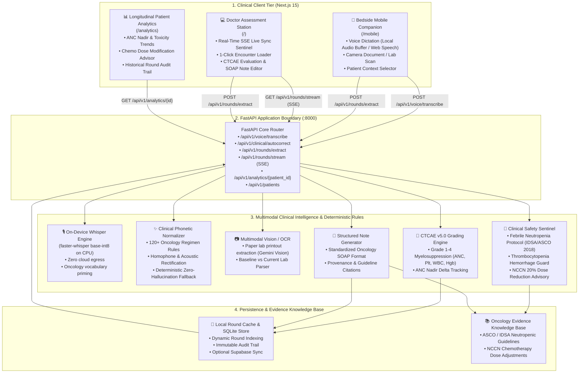
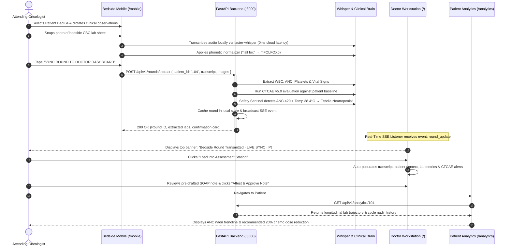

# 🩺 RoundsAI — Inpatient Oncology Ward Copilot & Real-Time Decision Support

> **Turn a 20-minute inpatient oncology round into a structured, evidence-linked clinical note in under 2 minutes — with zero cloud audio privacy leakage and ₹0 API cost.**

[-008080?style=flat&logo=target)](https://rounds-ai-umber.vercel.app/)
[](https://rounds-ai-umber.vercel.app/)
[](https://rounds-ai-umber.vercel.app/)
[](https://rounds-ai-backend.onrender.com/health)
[](https://youtu.be/Kia1C-a0QLk)
[](LICENSE)

[](https://fastapi.tiangolo.com)
[](https://nextjs.org)
[](https://www.typescriptlang.org)
[](https://www.python.org)
[](https://github.com/openai/whisper)
[](https://ai.google.dev)

---

## 🏆 Health-a-thon 2026 Build Sprint Deliverables

| S.No. | Deliverable | Format / Link | Description |
| :---: | :--- | :--- | :--- |
| **1** | **Functional Solution MVP** | **[rounds-ai-umber.vercel.app](https://rounds-ai-umber.vercel.app/)** | Working production deployment. Click **"Try demo"** for instant 1-click evaluator access into the live ward copilot with zero login required. |
| **2** | **Two-Page Solution Brief** | **[`docs/submissions/Deliverable_2_...pptx`](docs/submissions/Deliverable_2_Two_Page_Overview_BinaryMinds_1RKUPH.pptx)** | Completed official 2-page widescreen presentation brief. |
| **3** | **Final Presentation** | **[`docs/submissions/Deliverable_3_...pptx`](docs/submissions/Deliverable_3_Final_Presentation_BinaryMinds_1RKUPH.pptx)** | 12-slide comprehensive presentation covering clinical problem, architecture, validation, cost model, and deployment. |
| **4** | **Demo Walkthrough Video** | **[youtu.be/Kia1C-a0QLk](https://youtu.be/Kia1C-a0QLk)** | Narrated end-to-end video demonstration featuring bedside mobile capture, local Whisper STT, CTCAE v5.0 safety sentinels, and live desktop sync. |

---

## 👥 Team Binary Minds & Clinical Collaboration

- **Chalicheemala Surya Thejas** — Team Leader & Technical Lead (`suryathejas970@gmail.com`)  
  *Architected full-stack pipeline: FastAPI async gateway, real-time Server-Sent Events (SSE) live sync, CTCAE scoring engine, and clinical Next.js 15 workstation.*
- **Gaddam Sai Santhosh** — AI Systems Engineer (`saisanthosh05012006@gmail.com`)  
  *Designed on-device Whisper transcription pipeline, multimodal Gemini Vision OCR extraction, 120+ oncology phonetic normalizer, and automated test harnesses.*
- **Dr. Amrut S Kadam** — Clinical Lead & Doctor Partner (`raysoflife@gmail.com`)  
  *Inpatient Ward Attending, Victoria Hospital, Bangalore Medical College & Research Institute (BMCRI).*  
  *Co-designed oncology rounding workflows, validated CTCAE v5.0 myelosuppression grading thresholds, calibrated 120+ chemotherapy regimen phonetic rules, and verified IDSA/ASCO 2018 febrile neutropenia screening protocols.*

---

## 📋 Executive Overview

Inpatient oncology ward rounds represent one of the most cognitively taxing environments in clinical medicine. Attending oncologists and fellows must simultaneously synthesize bedside conversations, decipher physical laboratory printouts, calculate chemotherapy toxicity nadirs, and verify clinical practice guidelines under severe time constraints.

**RoundsAI** is a multimodal clinical intelligence copilot built specifically for the oncology inpatient ward:
- **Bedside Mobile Companion (`/mobile`)**: Clinicians dictate observations on the move or scan printed lab sheets using their mobile camera.
- **Privacy-First On-Device Whisper AI**: Voice dictation is transcribed 100% locally on CPU via `faster-whisper` (base int8) or native browser Web Speech API, ensuring **zero audio egress** and **₹0 cloud API billing**.
- **Specialized Oncology Normalizer**: A clinical phonetic engine corrects 120+ oncology acoustic homophones (*"fall fox"* $\rightarrow$ **mFOLFOX6**, *"anc nine hundred"* $\rightarrow$ **ANC 900 /µL**).
- **Instant Bedside-to-Desktop Synchronization**: 1-tap transmission immediately triggers a live Server-Sent Events (SSE) notification on the desktop workstation with 1-click encounter loading.
- **Automated CTCAE v5.0 Toxicity Grading**: Calculates baseline-to-current lab deltas and detects Grade 1–4 myelosuppression.
- **Comprehensive Grade 0–4 Demo Cases**: Seeded ward census includes complete clinical trajectories representing every CTCAE grade:
  - **Grade 4**: David Miller (`#104`, Bed 12) — Febrile neutropenia (ANC 420 /µL, T 38.4°C, secondary G-CSF protocol)
  - **Grade 3**: Sarah Jenkins (`#105`, Bed 14) — Severe neutropenia & low-grade fever (ANC 750 /µL, cycle delay)
  - **Grade 2**: Robert Chen (`#107`, Bed 18) — Moderate myelosuppression & fatigue (ANC 1,250 /µL, pre-infusion CBC surveillance)
  - **Grade 1**: Emily Watson (`#108`, Bed 20) — Mild myelosuppression & sensory neuropathy (ANC 1,750 /µL, full dose cleared)
  - **Grade 0 (Stable)**: Elena Rostova (`#106`, Bed 16) — Normal bone marrow recovery (ANC 1,620 /µL, 100% RDI continuation)
- **Clinical Notification Center**: Surfaces active ward alerts, warnings, and recovery notes by CTCAE urgency with 1-click mark as read and clear all.
- **Assistive Safety Sentinels**: Evaluates high-risk criteria (e.g. **Febrile Neutropenia** per IDSA/ASCO 2018) as `"Criterion met, for clinician review"` with neutral guideline citations.
- **Longitudinal Patient Analytics (`/analytics`)**: Charts ANC/WBC/Platelet nadirs across chemotherapy cycles, predicts recovery windows, and surfaces guideline-concordant dose modifications.
- **Hospital EMR Grade UI**: Clean, distraction-free interface built with vector SVG icons, tabular monospace lab typography (`tnum`), and strict 0-emoji compliance.

---

## 🏛️ System Architecture



---

## 🔄 End-to-End Clinical Round Flow



---

## ⚡ Key Features

### 1. High-Accuracy Voice & Zero-Cost Clinical Transcription
- **On-Device Whisper**: Employs `faster-whisper` (base int8) running locally on CPU. No external audio APIs required, ensuring zero audio egress in local mode and ₹0 per-minute billing.
- **120+ Specialized Oncology Regimens**: Normalizes acoustic homophones:
  - *Chemotherapy*: `"fall fox"` $\rightarrow$ `mFOLFOX6`, `"carbo taxol"` $\rightarrow$ `Carboplatin + Paclitaxel`, `"our chop"` $\rightarrow$ `R-CHOP`, `"fol fir inox"` $\rightarrow$ `FOLFIRINOX`.
  - *Lab Counts*: `"anc nine hundred"` $\rightarrow$ `ANC 900 /µL`, `"platelets one forty five k"` $\rightarrow$ `Platelets 145,000 /µL`.
  - *Clinical Terms*: `"a febrile"` $\rightarrow$ `afebrile`, `"sensory pare sthesia"` $\rightarrow$ `sensory paresthesia`.
- **Clinician Oversight Safeguard**: Displays automated diff notices with a 1-click **Undo** action to revert any automatic text change.

### 2. Bedside-to-Desktop Live Synchronization
- Bedside mobile companion sends captured speech, lab photographs, and selected patient bed.
- Desktop workstation features a Server-Sent Events (SSE) connection (`/api/v1/rounds/stream`) with automatic 5-second polling fallback.
- 1-click **"Load into Assessment Station"** transfers the complete encounter directly into the SOAP drafting interface.

### 3. Automated CTCAE v5.0 & Clinical Safety Sentinels
- **Febrile Neutropenia Screening**: Detects fever ($\ge 38.3^\circ\text{C}$ once or $\ge 38.0^\circ\text{C} \ge 1\text{h}$) alongside ANC $< 500/\mu\text{L}$ (Grade 4) or expected decline to $< 500/\mu\text{L}$ within 48h. Surfaces a `"Criterion met, for clinician review"` sentinel alert citing the IDSA/ASCO 2018 guideline.
- **Myelosuppression Grading**: Computes baseline vs. current lab deltas and classifies Grade 1–4 toxicities per CTCAE v5.0 (NCI).
- **Thrombocytopenia & Anemia Sentinels**: Flags critical platelet nadirs ($< 25,000/\mu\text{L}$) and severe anemia ($< 8.0\text{ g/dL}$) with neutral guideline citations.

### 4. Longitudinal Patient Analytics
- Cycle-over-cycle laboratory trend charts for Absolute Neutrophil Count (ANC), White Blood Cells (WBC), and Platelets.
- Real-time toxicity trajectory and clinical recovery estimation.
- Historical ward round timeline with clinician sign-off timestamps and approved SOAP notes.

### 5. Hospital-Grade UI & Typography
- Strict **0-emoji design standard** with 26 custom enterprise vector SVG icons.
- Tabular figures (`font-feature-settings: "tnum"`) for perfectly aligned clinical lab metrics.
- High-contrast clinical slate/navy color scheme.

---

## 🛠️ Technology Stack

| Layer | Technologies | Role |
| :--- | :--- | :--- |
| **Frontend** | Next.js 15 (App Router), React 19, TypeScript, Vanilla CSS | Doctor Workstation, Bedside Mobile Companion, Longitudinal Analytics |
| **Backend** | FastAPI, Python 3.12+, Uvicorn, Pydantic v2 | High-performance asynchronous REST API & clinical routing |
| **Local Speech AI** | `faster-whisper` (base int8), CTranslate2, Web Speech API | Offline, zero-cloud transcription on CPU |
| **Multimodal Vision** | Google Gemini 2.5 Flash SDK | Multimodal lab sheet transcription & document analysis |
| **Clinical Logic** | CTCAE v5.0 Scoring Matrix, NCCN / ASCO Guidelines | Deterministic toxicity grading and safety sentinels |
| **Data & Storage** | In-memory cache, SQLite store, optional Supabase integration | Longitudinal patient census & round audit logging |

---

## 📁 Repository Structure

```text
├── apps/
│   └── web/
│       ├── app/
│       │   ├── components/
│       │   │   └── Icons.tsx           # Hospital-grade vector SVG icons (0 emojis)
│       │   ├── mobile/page.tsx         # Bedside Mobile Capture Companion
│       │   ├── analytics/page.tsx      # Longitudinal Patient Analytics Dashboard
│       │   ├── login/page.tsx          # Clinician Authentication & Demo Mode
│       │   ├── page.tsx                # Doctor Assessment Station & SSE Live Sync
│       │   ├── layout.tsx              # Root Layout & Clinical Navigation Shell
│       │   └── styles.css              # Hospital EMR typography & theme styling
│       ├── lib/
│       │   ├── clinical-utils.ts       # CTCAE badge styles, lab trends, and clipboard notes
│       │   ├── clinical-utils.test.ts  # TDD unit test suite (22 tests passing in <6.5ms)
│       │   └── firebase.ts             # Firebase client configuration & auth
│       ├── package.json
│       └── tsconfig.json
├── backend/
│   ├── api/
│   │   └── main.py                     # FastAPI REST routes & application entrypoint
│   ├── agents/
│   │   └── round_graph.py              # Multi-agent clinical workflow & CTCAE rules
│   ├── models/
│   │   ├── analytics.py                # Longitudinal analytics schemas
│   │   ├── patient.py                  # Patient demographic & lab schemas
│   │   └── round.py                    # Round request/response schemas
│   ├── services/
│   │   ├── voice_transcriber.py        # Local faster-whisper base-int8 pipeline
│   │   ├── clinical_autocorrect.py     # 120+ oncology phonetic regex normalizer
│   │   ├── clinical_negation.py        # Deterministic acute vs historical negation engine
│   │   ├── lab_validation.py           # Biological plausibility range checks
│   │   ├── patient_analytics.py        # Longitudinal trends & CTCAE calculator
│   │   ├── persistence.py              # Thread-safe round cache & database storage
│   │   ├── gemini_extractor.py         # Gemini LLM clinical structured extractor
│   │   ├── gemini_vision.py            # Multimodal vision lab report extractor
│   │   ├── local_extractor.py          # Deterministic local regex extractor
│   │   ├── patient_service.py          # Patient census management
│   │   └── rag_service.py              # Clinical guideline retrieval & grounding
│   └── requirements.txt
├── docs/
│   ├── submissions/
│   │   ├── Deliverable_2_Two_Page_Overview_BinaryMinds_1RKUPH.pptx  # Prescribed 2-page brief
│   │   ├── Deliverable_3_Final_Presentation_BinaryMinds_1RKUPH.pptx # Prescribed 12-slide PPT
│   │   └── Round1_Idea_Pitch_Deck.pdf                              # Round 1 archive
│   ├── HACKATHON_SUBMISSION.md         # Comprehensive hackathon dossier
│   ├── demo-script.md                  # 5-minute presentation & demo script
│   └── architecture.md                 # System architecture overview
├── knowledge/
│   ├── Lab_Report_01.png               # Sample bedside CBC lab report scan
│   └── oncology_guidelines.json        # Curated NCCN/ASCO clinical guidelines
├── scripts/
│   └── verify_live_api.py              # End-to-end integration verification script
├── tests/
│   ├── conftest.py                     # Pytest fixtures and network guardrails
│   ├── test_api_pytest.py              # API contract, CORS, SSE & auth tests (20 tests)
│   ├── test_clinical_accuracy.py       # Clinical accuracy & CTCAE v5.0 tests (61 tests)
│   └── test_full_system.py             # Live integration test suite (8 tests)
├── .env.example                        # Documented environment template
├── Dockerfile                          # Production container specification
├── Procfile                            # Render / cloud deployment descriptor
├── pytest.ini                          # Pytest configuration (pythonpath = .)
├── README.md                           # Project documentation
├── render.yaml                         # Render deployment specification
└── vercel.json                         # Vercel deployment specification
```

---

## 🚀 Quickstart & Local Setup

### Prerequisites
- **Python**: 3.11 or higher
- **Node.js**: 18.x or higher (npm 9+)
- **Git**

### 1. Clone the Repository
```bash
git clone https://github.com/santhoshh005/Rounds_AI.git
cd Rounds_AI
```

### 2. Setup & Launch Backend
Open a terminal in the project root:

```powershell
# Create and activate Python virtual environment
py -m venv .venv
.\.venv\Scripts\Activate.ps1

# Install backend dependencies
pip install -r backend\requirements.txt

# Configure environment variables
Copy-Item .env.example .env

# Start FastAPI server
python -m uvicorn backend.api.main:app --host 0.0.0.0 --port 8000
```
*API health check is available at [http://localhost:8000/health](http://localhost:8000/health) and interactive Swagger documentation at [http://localhost:8000/docs](http://localhost:8000/docs).*

### 3. Setup & Launch Frontend
Open a second terminal in the `apps/web` directory:

```bash
cd apps/web
npm install
npm run dev
```
*Application is available at [http://localhost:3000](http://localhost:3000).*

---

## 🧪 Testing & Verification

RoundsAI includes a comprehensive, dual-stack test suite ensuring strict clinical correctness and zero regressions:

### Backend Test Suite (Pytest)
```powershell
# Run the complete clinical accuracy and API suite
pytest
```
- **61 Clinical Accuracy Tests** (`tests/test_clinical_accuracy.py`):
  - CTCAE v5.0 myelosuppression grading across boundary conditions (e.g. ANC 499 vs 500 /µL).
  - Acute fever vs. historical/negated fever differentiation (`"no fever"`, `"afebrile"`).
  - 120+ oncology phonetic regex corrections and Gemini polish diff verification guard.
  - Biological plausibility range checks.
- **20 API & Live Sync Tests** (`tests/test_api_pytest.py`):
  - CORS header validation across allowed origins.
  - Server-Sent Events (SSE) framing, keepalive, and real-time round broadcast delivery.
  - Unverified clinician attestation fallback headers.
  - Zero-key fallback behavior.

### Frontend Test Suite
```bash
cd apps/web
npm test
```
- **53 Unit Tests** (`apps/web/lib/clinical-utils.test.ts` & `oncology-autocorrect.test.ts`):
  - Executes in **~1.3s** via Node.js native test runner.
  - Verifies CTCAE badge styles, lab trend calculation, source provenance badges, oncology triad extraction, bed occupancy validation, Grade 0–4 dose modification recommendations, toast cleanups, doctor initials, and clinical notification center defaults.

---

## 🔒 Clinical Safety, Privacy & Accuracy Safeguards

### 1. Privacy Modes & Audio Egress Controls
RoundsAI is engineered with a strict privacy-first architecture controlled via `TRANSCRIPTION_MODE`:
- **`local` (Default — Zero Audio Egress)**: Voice recordings are processed entirely on-device on CPU via `faster-whisper` (int8 quantized) or in-browser Web Speech API. Zero audio bytes leave the clinician's workstation or device firewall, ensuring **₹0 cloud API fees**.
- **`cloud`**: Utilizes Google Gemini audio processing (`gemini-2.5-flash`) when cloud processing is explicitly authorized by hospital policy.
- **`hybrid`**: Attempts low-latency cloud transcription with seamless local on-device fallback if network connectivity drops.

### 2. Clinical Accuracy & Hallucination Prevention
- **Zero Invented Clinical Values**: The system never invents or hallucinates clinical metrics. Missing, ambiguous, or out-of-range values are flagged as `needs_confirmation` and surfaced in the interactive **"Confirm Before Signing"** review queue.
- **LLM Polish Diff Verification Guard**: Any LLM-assisted note polishing is verified against the original dictation via a strict diff checker. If any numeric digit, laboratory unit, medication name, or negation term is mutated, the LLM output is rejected immediately in favor of deterministic rule-based text.
- **Laboratory Normalization & Physiological Range Checks**: Standardizes units (e.g. ANC to `cells/µL`, Hemoglobin to `g/dL`, Platelets to `/µL`) and inspects biological plausibility boundaries, flagging possible 10× scaling or dictation errors for confirmation.
- **Deterministic Negation & Temporality Engine**: Uses rule-based regex parsing to differentiate acute ongoing fevers from negated or historical observations (`"no fever"`, `"afebrile"`, `"fever resolved"`, `"fever yesterday"` vs `"fever since yesterday"`), eliminating false-alarm Febrile Neutropenia alerts.
- **Deterministic CTCAE v5.0 Toxicity Grading**: Evaluates myelosuppression and toxicities against a canonical, versioned configuration table (`CTCAE v5.0, November 27, 2017`), citing standard practice guidelines (ASCO/IDSA and NCCN).
- **Human-in-the-Loop Attestation**: Notes remain strictly in `status="draft"` until a licensed clinician reviews and clicks **"ATTEST & APPROVE NOTE"**. Sign-off is locked while unconfirmed items remain in the queue.
- **Assistive Documentation Boundaries**: Alerts are strictly assistive and non-prescriptive, always phrased as `"Criterion met, for clinician review: ..."` rather than autonomous diagnostic claims or treatment orders.
- **Thread-Safe Resilient Persistence**: In-memory stores are protected by threading locks (`threading.Lock`), and database write failures trigger a prominent `"Saved Locally Only"` warning in the UI without losing clinician work.

---

## 🔑 Environment Variables Reference

| Variable | Required | Description |
| :--- | :--- | :--- |
| `GEMINI_API_KEY` | Optional | Enables Gemini vision OCR, extraction, and polish. Omit to run deterministic local mode. |
| `LLM_PROVIDER` | Optional | `local` (default) or `gemini`. |
| `GEMINI_MODEL_VISION` | Optional | Gemini model for lab image OCR (default: `gemini-2.5-flash`). |
| `TRANSCRIPTION_MODE` | Optional | `local` / `cloud` / `hybrid` (default: `local`). |
| `WHISPER_MODEL_SIZE` | Optional | `faster-whisper` model size (default: `base`). |
| `ALLOWED_ORIGINS` | Optional | Comma-separated CORS origins. |
| `REQUIRE_AUTH` | Optional | `true` to require `API_KEY` or Bearer token on all endpoints. |
| `API_KEY` | If REQUIRE_AUTH=true | Server-side API key for `X-API-Key` header or Bearer token. |
| `NEXT_PUBLIC_API_URL` | Optional | Backend URL for the frontend (default: `http://localhost:8000`). |
| `SUPABASE_URL` | Optional | Supabase project URL for cloud persistence. |
| `SUPABASE_SERVICE_ROLE_KEY` | Optional | Server-side only key for Supabase persistence. |
| `DEMO_MODE` | Optional | `true` enables synthetic demo trajectories labeled `[DEMO DATA]`. |
| `TEST_MODE` | Optional | `true` disables all cloud database writes for automated CI runs. |

---

## 📄 License & Clinical Disclaimer

This project is licensed under the **MIT License** — see the [LICENSE](LICENSE) file for details.

> [!CAUTION]
> **Research and Decision Support Prototype**: RoundsAI is designed exclusively as an assistive productivity and cognitive copilot for licensed healthcare professionals. It does not provide autonomous medical diagnoses, prescriptive clinical orders, or independent treatment directives. All clinical evaluations, CTCAE grading, and generated notes require explicit review and attestation by a qualified clinician before inclusion in any permanent electronic medical record (EMR).
